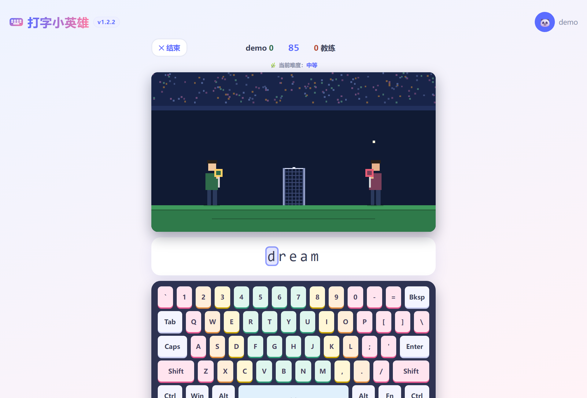
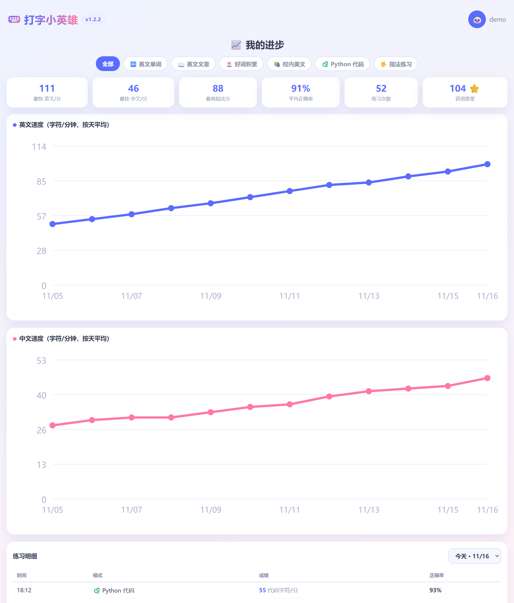

# 打字小英雄 · TypingHero

一个给孩子用的中文打字练习游戏。**单个 HTML 文件，双击即玩，零依赖、零构建、完全离线。**

把打字练习做成打球：屏幕上飞来一个单词，打对了就是挥拍击球，打得越快越容易杀球得分。

> 当前版本 **v1.2.2**（2026-11-16）
> 面向小学生设计，但成年人用来练速度、练指法同样合适。

## 界面预览

| 首页 | 羽毛球模式 |
|---|---|
|  |  |

| 指法练习 | 成绩统计 |
|---|---|
|  |  |

## 为什么做这个

给孩子的打字软件通常有两个问题：一是要装客户端、注册账号、联网；二是练习内容脱离课堂——练的是随机单词，考的是游戏分数。

这个项目想做到三件事：

- **打开就能用**：一个 HTML 文件，不装东西、不联网、不收集数据
- **练的是课本**：成语、校内美文、作文好句、Python 代码，都是孩子正在学的内容
- **有反馈但不焦虑**：速度用动物和食物分档，打错了退格重来不扣分，漏球只丢一分不结束游戏

## 功能特性

### 六种模式

| 模式 | 内容 | 说明 |
|---|---|---|
| 🔤 英文单词 | 100 个单词 | 从 3 字母短词到 11 字母长词，四级递进 |
| 📖 英文短文 | 12 篇短文 | 练连贯输入和耐力 |
| 🀄 好词积累 | 831 条成语 | 按品德基础 → 为人处事 → 修身律己 → 君子之道分四级，每条带拼音 |
| 📚 校内美文 | 16 篇 | 作文好句、六年级名篇、初一衔接古诗文，带拼音 |
| 🐍 Python 代码 | 40 段 | 从 `print` 到 JSON / messages / tools，为 AI 学习打基础 |
| 🖐️ 指法练习 | 6 关 | 中排定位 → 三排混合 → 大写 Shift，键盘按手指分区上色 |

### 🏸 羽毛球模式

把打字变成对打：

- 屏幕上方飞来羽毛球，下方显示一个单词，**一字不差打完即击球**
- 球飞得越高被击中，说明你打得越快：**杀球 +2 分、平抽 / 挑高 +1 分、漏球 0 分**
- 球不会等你，但**漏球也不会结束游戏**，扣分继续打
- 速度自适应：根据你的历史表现动态调整发球节奏，打得快球就快，打得慢球就等
- 三档难度：简单 60 秒 / 中等 90 秒 / 困难 120 秒，各有独立最佳成绩与星级门槛
- 248 个专用词，按长度分四级，整局去重
- Canvas 2D 绘制球场、球路、击球特效与观众席

### 反馈与激励

- **速度档位**：中英文各 15 档。英文从草履虫一路到火箭，中文从白粥到和牛，每档配图标与一句评价
- **星级评价**：练习按正确率给星（≥95% 三星 / ≥85% 两星 / ≥60% 一星）
- **指法分**：击键正确率 60 分 + 节奏稳定度 25 分 + Shift 规范度 15 分，称号从「指尖学徒」到「盲打高手」
- **进度图**：SVG 手绘折线，按天展示中英文速度与指法分，可查看每天每次练习的明细
- **隐藏彩蛋**：英文超过 450 字符/分、中文超过 200 字符/分，会触发特殊评价

### 其他

- 多用户支持：每个孩子一个本地账号，成绩分开记录
- 键盘可视化：高亮下一个要按的键；指法模式额外显示双手示意与当前手指
- 中文输入：兼容系统输入法的组词过程（`compositionstart` / `compositionend`），不会把拼音当成错字
- 全中文界面，适配手机与平板（`max-width: 640px` 断点）；手机上可配合系统输入法练习，但体验以电脑物理键盘为佳

## 快速开始

**最简单的方式**：双击 `index.html`，用 Edge / Chrome 打开。

需要本地服务器时（某些浏览器对 `file://` 的存储有限制）：

```bash
python -m http.server 8000
# 然后访问 http://localhost:8000/
```

也可以直接放进 GitHub Pages：仓库设置 → Pages → 选择 `main` 分支根目录，即可得到一个在线试玩地址。

首次进入需要注册一个名字（最多 8 个字符）和至少 4 位密码，用于区分不同孩子的成绩。

## 项目结构

```
index.html                     # 完整应用：样式、素材、逻辑全在这一个文件里
打字小英雄 - v1.0归档.html      # 初代版本，留作对照
docs/screenshots/              # README 用截图
LICENSE
README.md
```

单个文件约 170 KB，没有 `package.json`、没有 `node_modules`、没有构建步骤。

## 技术实现

- **纯原生**：HTML + CSS + 原生 JS，无框架、无第三方库、无外部字体与 CDN 请求
- **Canvas 2D**：羽毛球场景（球路、拖尾、粒子、冲击环、镜头震动）
- **内联 SVG**：速度统计折线图与图标，随容器自适应
- **WebAudio**：程序化生成击球音效，不依赖音频文件
- **localStorage**：账号、成绩、最佳记录全部保存在本机

代码内按区块组织：`版本元信息 → 常量 → 素材库 → 工具函数 → 练习逻辑 → 成绩统计 → 羽毛球模式`。

## 自定义

### 修改素材

素材集中在 `MAT` 对象里，结构直观：

```js
MAT.cn_word = {
  1: [['尊师重道', 'zun shi zhong dao'], ['勤学守规', 'qin xue shou gui']],
  // ...
}
```

中文素材必须带拼音（用空格分隔音节），页面的拼音校验会在数量不匹配时直接报错，避免错位。

### 家长寄语

首页可以显示家长写给孩子的随机寄语，默认为关闭。找到 `FAMILY_NOTE`，把孩子登录名和想说的话填进去：

```js
const FAMILY_NOTE={
  child:'xiaoming',
  notes:['慢一点没关系，今天比昨天多按对几个键，就是在往前走。']
};
```

`child` 留空则完全不显示此区域。

### 修改版本号

版本信息只有一处来源：`<head>` 里的 `#app-meta` JSON。改 `version` 和 `updatedAt`，并在 `history` 顶部追加记录，页头徽标会自动同步。

## 已知限制

- **密码不是加密存储**：本地账号只是为了区分孩子，密码用 base64 编码存在 localStorage 里，**请不要使用真实密码**
- **数据不会自动备份**：清空浏览器数据会丢失成绩，换电脑也不会同步
- **指法判定是间接的**：浏览器拿不到「实际是哪根手指按的」，指法模式靠分区引导与节奏稳定性评分，唯一能硬检测的是大写时是否按了另一侧的 Shift
- 手机端没有做触摸反馈优化，主要面向电脑键盘

## 致谢

这个项目最初是爸爸给儿子做的打字练习工具，后来一点点长成了现在这样。素材里的成语、篇章与代码片段，都是按「孩子正在学什么」来挑的。

欢迎 Issue 和 PR，特别是：更多适合小学生的练习素材、无障碍改进、以及移动端适配建议。

## 许可证

[MIT](LICENSE) © 2026 huhan1239-png

你可以自由使用、修改、分发，包括商业用途，保留版权声明即可。
