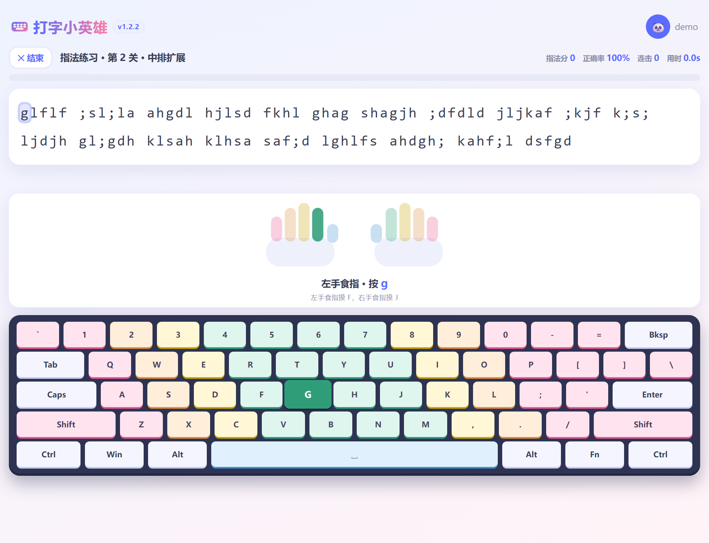
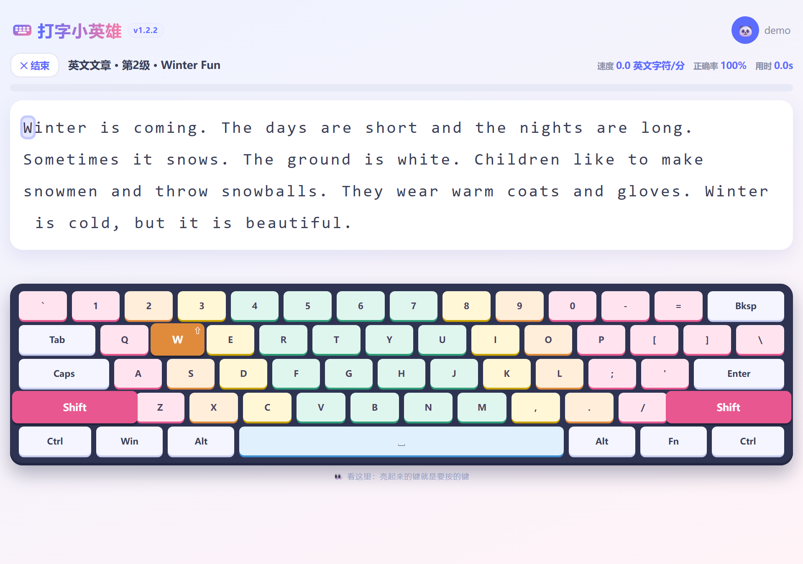
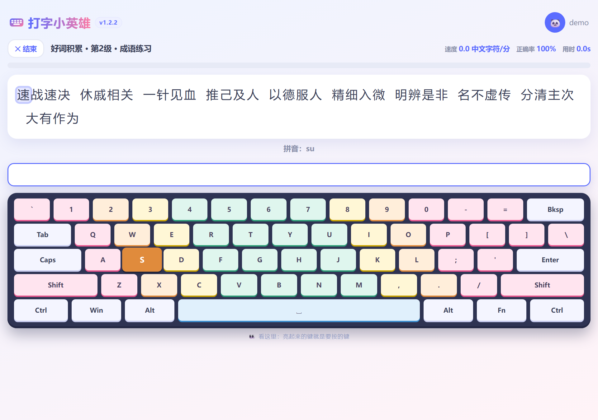
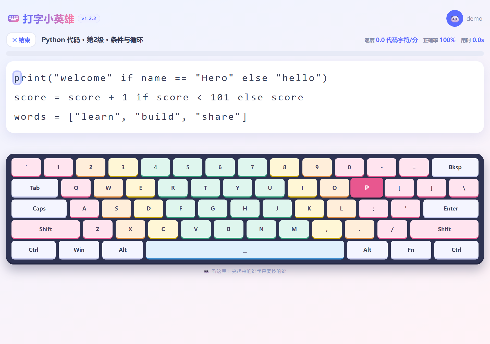
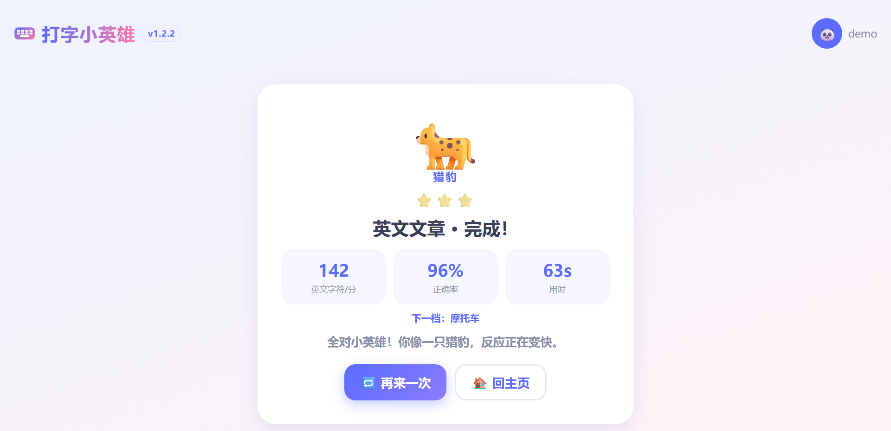
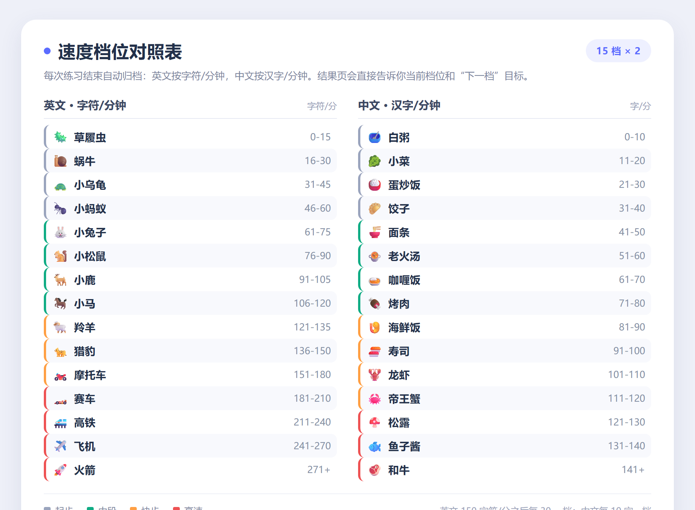

# 打字小英雄 · TypingHero

一个给小学生用的打字练习工具。**单个 HTML 文件，双击即玩，零依赖、零构建、完全离线。**

**推荐给家长或老师使用**：给孩子练指法、巩固课内内容，或者直接在课堂上当打字热身工具。

现在的孩子习惯了手机和平板的触屏输入，但真正开始学计算机、上手写代码时，基础指法仍然绕不过去。

所以想做一套合集：**指法训练 + 中英文课堂内容积累 + Python 基础代码**。素材尽量贴合孩子在学校正在学的内容——成语、校内美文、作文好句、初小衔接的古诗文，以及能直接运行的 Python 小段代码。在练打字的同时，也顺带完成一遍知识积累。

孩子愿不愿意练，是这类工具最难的一关。为此设计了一套奖励系统，用即时的、看得见的反馈把练习变成「再来一局」：速度有动物档位，正确率有星星，指法有分数和称号，每天还有一条属于自己的进步曲线。这套机制在自家孩子身上验证过：**一周时间，从「一指禅」练到「猎豹」档（136–150 字符/分钟），已经足够应付课堂使用。**

目前这个软件已经提交给孩子所在的编程学习机构，供同班同学使用，反馈良好。这次开放出来，一是希望更多孩子用得上，二是把它作为孩子一次 vibe coding 实践的正向反馈，留个记录。

> 当前版本 **v1.2.2**（2026-11-16）

## 界面预览


| 指法练习 | 练习 · 英文文章 |
|---|---|
|  |  |

| 练习 · 好词积累 | 练习 · Python 代码 |
|---|---|
|  |  |

| 结算页 · 星级与速度档位 |
|---|
|  |

**速度档位对照表 · 结算页的档位即来源于此**



**成绩统计 · 速度曲线**


## 目标用户

**主要用户：小学中高年级（约 8–12 岁）**

- 正在上信息技术课、开始需要独立用电脑完成作业的孩子
- 刚开始学 Python、需要熟悉括号、引号、冒号这些符号的孩子
- 指法还是一指禅、打字速度跟不上思维速度的孩子

**也适合**

- 想重新校准指法的成年人：内容偏基础，但指法训练和速度档位同样有效
- 家长陪练：多个账号各自记录成绩，可以对照看每天的变化

**使用前提与场景**

- 一台带物理键盘的电脑，用 Edge / Chrome 打开即可
- 不需要联网，不收集任何数据
- 单次练习 1–3 分钟，适合课前热身、课后十分钟、寒暑假每天一组
- 家长可以设置家长寄语、查看每天的速度曲线

**设计上刻意避开的**

- 不做排行榜和多人对战，避免孩子之间攀比速度和名次
- 不惩罚错误：打错只需退格重来，不会中断练习或额外扣分
- 练习内容跟着课内进度走，不用面对一堆陌生词库

## 功能特性

### 五种练习内容

| 模式 | 内容 | 说明 |
|---|---|---|
| 🔤 英文单词 | 100 个单词 | 从 3 字母短词到 11 字母长词，四级递进 |
| 📖 英文文章 | 12 篇短文 | 日常场景小短文，练连贯输入与耐力 |
| 🀄 好词积累 | 831 条成语 | 品德基础 → 为人处事 → 修身律己 → 君子之道，每条带拼音 |
| 📚 校内美文 | 16 篇 | 作文好句、六年级名篇、初一衔接古诗文，带拼音 |
| 🐍 Python 代码 | 40 段 | 从 `print` 到 JSON / messages / tools，为 AI 学习打基础 |

每类内容都分四级难度，从「先练练手」到「小小打字高手」，孩子可以按自己的节奏往上走。

### 指法训练

- 6 个关卡：中排定位（`asdf jkl;`）→ 中排扩展 → 上排 → 下排 → 三排混合 → 大写与 Shift
- 键盘按**手指分区上色**，每根手指对应一种颜色
- 下方有一双**手部示意图**，实时提示这一下该用哪根手指
- 大写字母会提醒用**另一只手的小指**按 Shift，并检测是否真的按对了
- 浏览器拿不到「实际是哪根手指按的」，所以教学靠分区引导，评分靠可测量的指标（见下文）

### 奖励系统

奖励系统是整套工具的核心，原则是：**反馈要快、要看得懂、要能接得上下一步。**

**1. 逐键的即时反馈**

打对的部分立刻变绿，当前要按的字符高亮；下方键盘会亮起对应的键，并按手指分区着色。按错时键盘会轻轻抖一下，提醒手滑了。孩子不需要读任何说明，跟着高亮走就能打。

**2. 15 档速度等级**

每次练习结束，结果页会给出一个档位：大图标、档位名、一句对应的评价，以及「下一档：摩托车」这样的距离提示。


英文前段每 15 字符一档，刚起步时也能密集看到进步；中文按中文字符/分钟计算。**「下一档是什么」比「你排第几」更能驱动孩子继续练。**

**3. 星级评价**

练习按正确率给星：≥95% 三星、≥85% 两星、≥60% 一星。拿到两星及以上会撒花。星级同时累计到总星星数，成为长期目标。

**4. 指法分与称号**

指法练习按三个可测量的维度打分：

| 维度 | 分值 | 衡量什么 |
|---|---|---|
| 击键正确率 | 60 分 | 第一遍就按对的键占比 |
| 节奏稳定度 | 25 分 | 按键间隔是否均匀，忽快忽慢会掉分 |
| Shift 规范度 | 15 分 | 大写是否用了对侧的小指 Shift |

总分对应四个称号：指尖学徒（<65）、指法小徒弟（65–81）、指法小师傅（82–91）、盲打高手（≥92）。结算页会展开三项得分，并给出具体建议，比如「手指回到定位键再出发，节奏会更均匀」。

**5. 成长可视化**

成绩页按天绘制中英文速度与指法分曲线，下方可以选择日期查看当天每一次练习的明细。指标卡展示最快英文速度、最快中文速度、最高指法分、平均正确率、练习次数和累计星星。孩子看得见「这条线在往上走」，比任何说教都管用。

**6. 隐藏成就**

英文超过 450 字符/分、中文超过 200 字符/分，会触发两个彩蛋评价（水滴 / 满汉全席）。这类成绩不计入曲线，纯粹作为惊喜。

## 彩蛋：家长寄语

内置一个寄语系统：指定账号登录后，首页会随机显示一条家长写下的话。

它被做成了可配置项，源码里不含任何个人信息：

```js
const FAMILY_NOTE={
  child:'xiaoming',           // 孩子的登录名，留空则关闭
  notes:[
    '慢一点没关系，今天比昨天多按对几个键，就是在往前走。',
    '打错了按退格重来就好，错了就改，改了就继续。'
  ]
};
```

家长可以把自己想说的话写进去，让练习时间多一点亲子交流。默认关闭，不影响正常使用。

## 快速开始

**最简单的方式**：双击 `index.html`，用 Edge / Chrome 打开。

需要本地服务器时（某些浏览器对 `file://` 的存储有限制）：

```bash
python -m http.server 8000
# 然后访问 http://localhost:8000/
```

也可以直接放进 GitHub Pages：仓库设置 → Pages → 选择 `main` 分支根目录，即可得到一个在线试玩地址。

首次进入需要注册一个名字（最多 8 个字符）和至少 4 位密码，用于区分不同孩子的成绩。

## 项目结构

```
index.html                     # 完整应用：样式、素材、逻辑全在这一个文件里
打字小英雄 - v1.0归档.html      # 初代版本，留作对照
docs/screenshots/              # README 用截图
LICENSE
README.md
```

单个文件约 170 KB，没有 `package.json`、没有 `node_modules`、没有构建步骤。

## 技术实现

- **纯原生**：HTML + CSS + 原生 JS，无框架、无第三方库、无外部字体与 CDN 请求
- **内联 SVG**：速度统计折线图与手部示意图，随容器自适应
- **localStorage**：账号、成绩、最佳记录全部保存在本机
- **中文输入**：监听 `compositionstart` / `compositionend`，兼容系统输入法的组词过程，不会把拼音当成错字

代码内按区块组织：`版本元信息 → 常量 → 素材库 → 工具函数 → 练习逻辑 → 成绩统计`。

## 自定义

### 修改素材

素材集中在 `MAT` 对象里，结构直观：

```js
MAT.cn_word = {
  1: [['尊师重道', 'zun shi zhong dao'], ['勤学守规', 'qin xue shou gui']],
  // ...
}
```

中文素材必须带拼音（用空格分隔音节），页面的拼音校验会在数量不匹配时直接报错，避免错位。

### 修改版本号

版本信息只有一处来源：`<head>` 里的 `#app-meta` JSON。改 `version` 和 `updatedAt`，并在 `history` 顶部追加记录，页头徽标会自动同步。

## 已知限制

- **密码不是加密存储**：本地账号只是为了区分孩子，密码用 base64 编码存在 localStorage 里，**请不要使用真实密码**
- **数据不会自动备份**：清空浏览器数据会丢失成绩，换电脑也不会同步
- **指法判定是间接的**：浏览器拿不到「实际是哪根手指按的」，指法模式靠分区引导与节奏稳定性评分，唯一能硬检测的是大写时是否按了另一侧的 Shift
- **移动端**：界面适配了平板与手机断点，但没有做触摸优化，体验以电脑物理键盘为准
- **羽毛球模式**：早期实验玩法仍在代码中，效果不理想，文档不再介绍，后续可能移除

## 致谢

这个项目最初是爸爸给儿子做的打字练习工具，后来一点点长成了现在这样。素材里的成语、篇章与代码片段，都是按「孩子正在学什么」来挑的。

目前已用于孩子所在编程学习机构的同班同学，欢迎 Issue 和 PR，特别是：更多适合小学生的练习素材、无障碍改进、以及移动端适配建议。

## 许可证

[MIT](LICENSE) © 2026 huhan1239-png

你可以自由使用、修改、分发，包括商业用途，保留版权声明即可。
